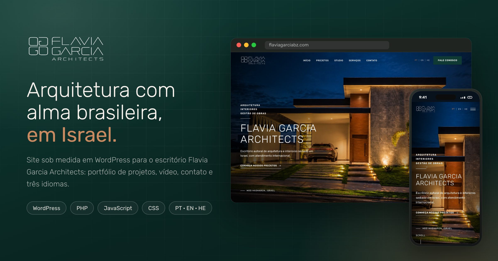
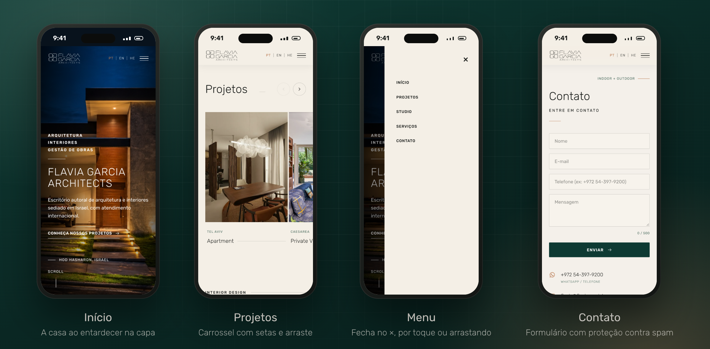
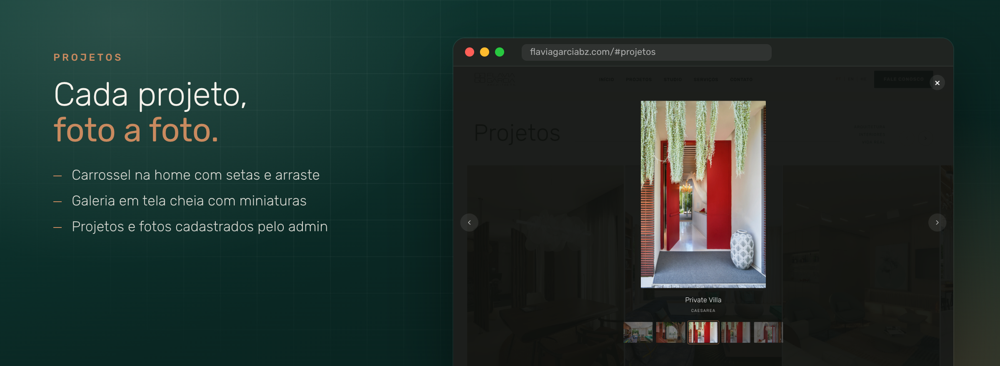
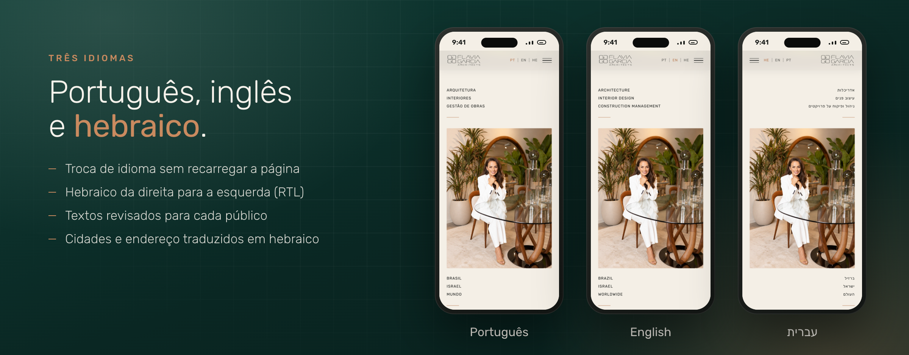
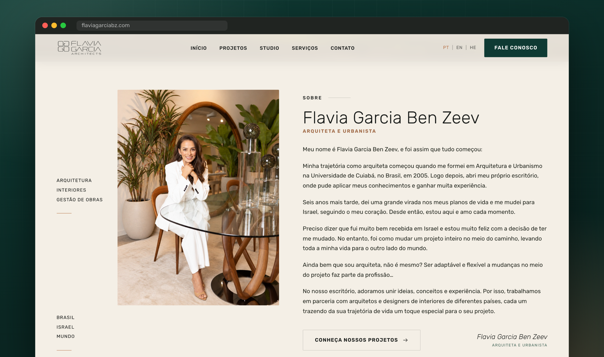
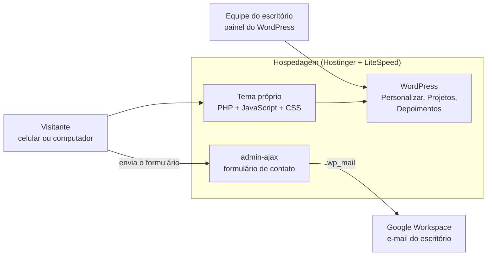

  

<h1 align="center">Flavia Garcia Architects</h1>

  Site sob medida em WordPress para um escritório de arquitetura e interiores em Israel, 
  com portfólio de projetos, vídeo, contato e três idiomas: português, inglês e hebraico.

  
  
  
  
  
  

> **Sobre este repositório:** esta é a vitrine do projeto, com imagens, recursos e decisões técnicas. O código-fonte do tema é privado.

---

## Sumário

- [O projeto](#o-projeto)
- [Para quem é](#para-quem-é)
- [Principais recursos](#principais-recursos)
- [Três idiomas](#três-idiomas)
- [Como foi construído](#como-foi-construído)
- [Decisões técnicas](#decisões-técnicas)
- [Qualidade e testes](#qualidade-e-testes)
- [Próximos passos](#próximos-passos)
- [Autor](#autor)

---

## O projeto

A Flavia Garcia Architects é um escritório de arquitetura e interiores de Hod Hasharon, em Israel, fundado por uma arquiteta brasileira. O site antigo, feito num construtor de sites genérico, não mostrava bem o que o escritório tem de mais forte: projetos residenciais com muita luz natural, materiais e a conexão entre interior e exterior.

O desafio era criar um site com cara de revista de arquitetura, que a própria equipe consiga atualizar, e que fale com três públicos ao mesmo tempo: clientes brasileiros, clientes internacionais e clientes israelenses, em hebraico.

## Para quem é

- **Clientes em Israel** que procuram um escritório de arquitetura e interiores e leem em hebraico.
- **Brasileiros e estrangeiros** que moram ou investem em Israel e preferem português ou inglês.
- **A equipe do escritório**, que troca fotos, projetos, vídeo e textos pelo painel do WordPress, sem mexer em código.

## Principais recursos

  

| Recurso | O que faz |
|---|---|
| **Capa** | Foto da casa ao entardecer em tela cheia, com degradê nas laterais para a leitura dos textos e chamada para os projetos. |
| **Projetos** | Carrossel na página inicial com setas e arraste. Cada projeto abre numa galeria em tela cheia, com miniaturas para escolher a foto. |
| **Cadastro pelo painel** | Projetos, galeria de fotos, localização e depoimentos são cadastrados no WordPress. Sem nada cadastrado, o tema monta os projetos sozinho a partir das pastas de fotos. |
| **Vídeo** | Seção de vídeo com player em janela sobre a página. Aceita arquivo MP4 ou link do YouTube/Vimeo, trocável pelo Personalizar. |
| **Sobre** | Biografia da arquiteta, com foto, assinatura e áreas de atuação. |
| **Depoimentos** | Depoimentos de clientes com aspas em destaque e localização traduzida. |
| **Contato** | Formulário com mensagens por campo, telefone internacional e proteção contra spam, além de WhatsApp, e-mail, endereço e mapa. |
| **Menu no celular** | Painel lateral que fecha pelo ×, por toque fora, pela tecla Esc ou arrastando. Os idiomas ficam sempre no cabeçalho. |
| **Identidade visual** | Logo oficial que muda de cor junto com o cabeçalho, paleta natural (bege, verde-petróleo e terracota) e fonte Rubik, que também tem hebraico. |

  

## Três idiomas

  

- A troca de idioma acontece na hora, sem recarregar a página, e vale para o site inteiro: menus, textos longos, formulário, mensagens de erro e rótulos de acessibilidade.
- Em hebraico, o site passa a ser lido da direita para a esquerda (RTL): menu, cartões, carrossel, galeria, formulário e o painel do menu no celular.
- Cidades, endereço e localização dos projetos ganham versão em hebraico. Telefones e trechos em inglês continuam na ordem certa dentro do texto em hebraico.
- Os textos foram revisados para o público de cada idioma, e não traduzidos palavra por palavra.

  

## Como foi construído

| Camada | Tecnologias |
|---|---|
| Tema | WordPress com tema próprio em PHP 8, sem construtor de páginas |
| Interface | HTML, CSS e JavaScript puro, sem frameworks no site |
| Conteúdo | Personalizar do WordPress, tipo de conteúdo "Projetos" com galeria, depoimentos e campos próprios |
| Idiomas | Dicionário PT/EN/HE no navegador, com troca para RTL no hebraico |
| Hospedagem | Hostinger com LiteSpeed Cache |
| Testes | Playwright com Chromium e Google Chrome, simulando desktop e celular |

## Decisões técnicas

**Tema próprio, sem construtor de páginas.** O site carrega só o que usa: um CSS, um JavaScript e as fontes. Fica mais leve e mais estável do que um construtor visual, e a equipe continua editando o conteúdo pelo painel.

**Idiomas no navegador.** Cada texto tem uma chave, e a troca de idioma substitui os textos e muda a direção da página sem recarregar. Textos que a equipe edita no painel, como a capa e o endereço, têm um campo para cada idioma.

**Formulário protegido sem incomodar quem escreve.**
- Campo-armadilha invisível e tempo mínimo de preenchimento: robôs recebem uma falsa confirmação e nenhum e-mail sai.
- Limite de envios por endereço de IP, considerando o IP real atrás do Cloudflare.
- O formulário pede um código de segurança novo antes de cada envio, então continua funcionando mesmo quando a página vem de um cache antigo.
- Validação no navegador e no servidor, com telefone internacional e nomes em qualquer alfabeto, incluindo hebraico.

**Cache sem dor de cabeça.** CSS, JavaScript e vídeo ganham uma versão que muda sempre que o arquivo muda. Assim, o navegador e o CDN não seguram arquivos antigos depois de uma atualização.

**Conteúdo que nunca quebra.** Sem projetos cadastrados, o tema monta o portfólio a partir das pastas de fotos. Sem vídeo cadastrado, a seção mostra só a imagem, sem botão de play.

**Acessibilidade.** Botões com rótulos traduzidos, foco visível pelo teclado, Esc para fechar menu, galeria e vídeo, e textos alternativos nas imagens.

## Qualidade e testes

- **Navegador automatizado com Playwright:** carrossel, galeria com miniaturas, menu no celular (×, toque fora, Esc e arraste), botão de voltar ao topo e alinhamento das seções.
- **Idiomas:** teste que troca para PT, EN e HE e confere se algum texto ficou vazio, se os textos batem com a versão aprovada e se aparece rolagem horizontal no hebraico.
- **Formulário:** envio sem código de segurança, robô pelo campo-armadilha, envio rápido demais, telefone inválido e sexto envio seguido bloqueado.
- **Vídeo:** reprodução real no Google Chrome, além de links do YouTube e do Vimeo em vários formatos.
- **Instalação:** o zip do tema é instalado num WordPress limpo antes de cada entrega.

## Próximos passos

- [ ] Migrar o domínio para o novo site, mantendo o e-mail do escritório
- [ ] Enviar os e-mails do formulário pela conta Google do escritório (SMTP)
- [ ] Redirecionar os endereços do site antigo para as páginas novas
- [ ] Páginas próprias para cada projeto, com textos nos três idiomas

## Autor

**Thiago Alves**: design de interface e desenvolvimento do tema, do layout aos testes.

- LinkedIn: _adicione o seu link_
- E-mail: _adicione o seu contato_

---

Imagens capturadas do site em desenvolvimento. Marca, fotos dos projetos e textos pertencem à Flavia Garcia Architects.
